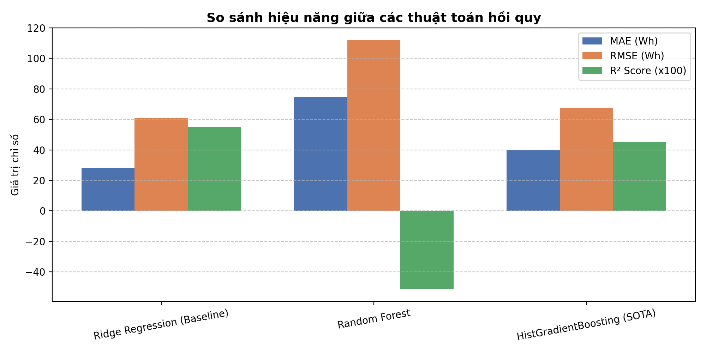
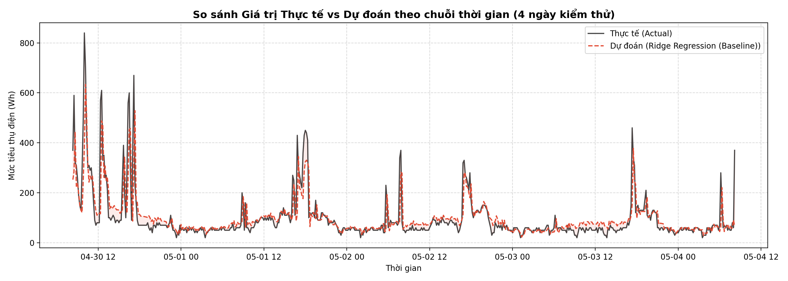

# ⚡ Hệ Thống Dự Đoán Tiêu Thụ Điện Trong Nhà Thông Minh
> **Đề tài số 10** - Báo cáo & Sản phẩm thực nghiệm Trí tuệ nhân tạo (AI / Machine Learning)  
> **Tập dữ liệu:** Appliances Energy Prediction (UCI Machine Learning Repository)  
> **Tác giả:** [Finifigal](https://github.com/Finifigal)

---

## 📌 1. Giới thiệu đề tài
Dự án xây dựng mô hình học máy hồi quy (Regression) nhằm dự đoán mức tiêu thụ điện năng (`Appliances` - đơn vị Wh) trong một ngôi nhà thông minh dựa trên:
* Cảm biến nhiệt độ ($T_1 \dots T_9$) và độ ẩm ($RH_1 \dots RH_9$) bố trí tại 9 khu vực phòng (Bếp, Khách, Giặt, Làm việc, Tắm, Mặt ngoài nhà, Ủi đồ, Phòng ngủ thiếu niên, Phòng ngủ cha mẹ).
* Dữ liệu thời tiết từ trạm khí tượng bên ngoài ($T_{out}$, $Press$, $RH_{out}$, $Windspeed$, $Visibility$, $Tdewpoint$).
* Mức độ sử dụng ánh sáng (`lights`) và chu kỳ thời gian hoạt động trong ngày/tuần.

---

## 🚀 2. Điểm nổi bật về phương pháp luận
1. **Phân chia chuỗi thời gian (Time-Series Split):** Tuyệt đối không xáo trộn ngẫu nhiên dữ liệu (`shuffle=False`), 80% thời gian đầu dùng để Train, 20% thời gian sau làm Test độc lập nhằm chống rò rỉ dữ liệu tương lai (**Data Leakage**).
2. **Kỹ thuật đặc trưng (Feature Engineering):**
   * Mã hóa chu kỳ thời gian 24h qua hàm tuần hoàn `sin_hour`, `cos_hour`.
   * Tính các chỉ số không gian: Nhiệt độ trung bình toàn nhà ($T_{indoor\_mean}$), độ ẩm trung bình toàn nhà ($RH_{indoor\_mean}$).
   * Độ chênh lệch nhiệt/ẩm giữa trong nhà và môi trường trạm thời tiết ($T_{diff\_out}$, $RH_{diff\_out}$).
   * Bổ sung quán tính tiêu thụ điện chu kỳ trước (`Appliances_lag1`).
3. **Loại bỏ biến nhiễu:** Loại bỏ 2 biến kiểm thử `rv1`, `rv2` được UCI chèn vào để tránh mô hình học vẹt trên nhiễu ngẫu nhiên.
4. **So sánh đa thuật toán:** Đánh giá đối chứng giữa **Ridge Regression (Baseline)**, **Random Forest Regressor** và **HistGradientBoosting (SOTA)**.

---

## 📊 3. Kết quả thực nghiệm

| Mô hình / Thuật toán | MAE (Wh) | RMSE (Wh) | $R^2$ Score | MAPE (%) | Đánh giá |
| :--- | :---: | :---: | :---: | :---: | :--- |
| **Ridge Regression (Baseline)** | **28.26** | **60.99** | **0.5511** | **26.90%** | **Tối ưu nhất:** Ổn định cao, không bị overfit bởi gai xung điện đột biến |
| **HistGradientBoosting (SOTA)** | 40.07 | 67.35 | 0.4527 | 43.73% | Học tốt các phân nhánh phi tuyến tính phức tạp |
| **Random Forest** | 74.60 | 111.93 | -0.5117 | 86.00% | Dễ nhạy cảm với các đột biến tiêu thụ điện |

---

## 🖼️ 4. Biểu đồ trực quan hóa

| So sánh hiệu năng mô hình | Thực tế vs Dự đoán theo thời gian |
| :---: | :---: |
|  |  |

---

## 💻 5. Hướng dẫn cài đặt & Chạy ứng dụng

### 1. Cài đặt thư viện:
```bash
pip install -r requirements.txt
```

### 2. Huấn luyện lại mô hình (nếu cần):
```bash
python train.py
```

### 3. Khởi động Web Dashboard (Streamlit):
```bash
python -m streamlit run app.py
```
*Truy cập trình duyệt tại địa chỉ `http://localhost:8501` để trải nghiệm giao diện dự đoán tương tác.*

---

## 📁 6. Cấu trúc thư mục dự án
```
CuoiKy_AI/
│
├── data/
│   └── energydata_complete.csv     # Dữ liệu gốc UCI (19,735 dòng)
├── outputs/
│   ├── benchmark_results.csv       # Bảng số liệu MAE, RMSE, R2
│   ├── best_energy_model.pkl       # Trọng số mô hình tối ưu đã lưu
│   ├── actual_vs_predicted.png     # Đồ thị Actual vs Predicted
│   ├── feature_importance.png      # Đồ thị Top đặc trưng quan trọng
│   └── metrics_comparison.png      # Biểu đồ cột so sánh mô hình
│
├── app.py                          # Giao diện Web Streamlit Dashboard
├── train.py                        # Pipeline huấn luyện & xuất kết quả
├── predict.py                      # Module suy luận dòng lệnh
├── requirements.txt                # Danh sách thư viện phụ thuộc
├── .gitignore                      # Loại bỏ file cache rác
└── README.md                       # Tài liệu thuyết minh dự án
```
